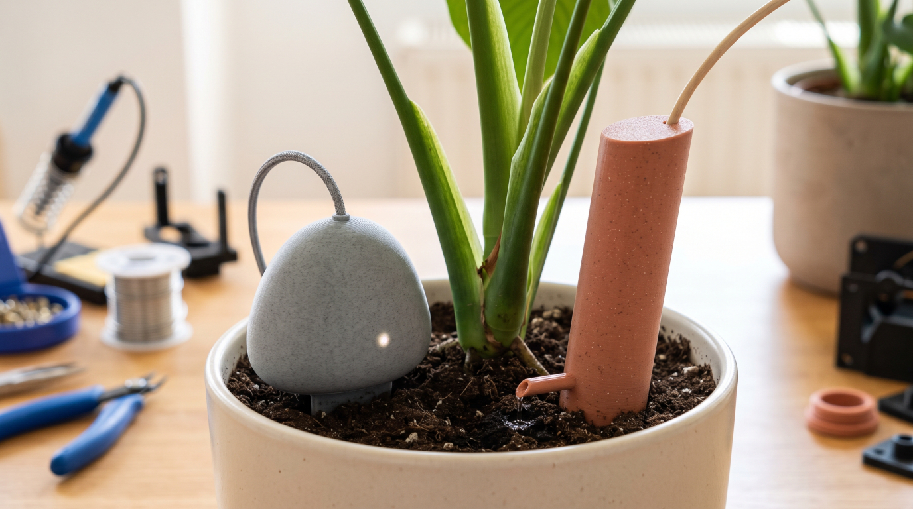

# VATTEN

> *Vatten* : « eau » en suédois.

Système d'arrosage automatique pour plantes d'intérieur, au design scandinave épuré : formes douces, aspect minéral et céramique, imprimé en 3D (PLA mat, terracotta ou effet marbre).



## Principe

La plupart des arroseurs mesurent et arrosent au même endroit, ce qui fausse la lecture du capteur au moment de l'arrosage. VATTEN **sépare physiquement la mesure et l'injection d'eau** (5 à 15 cm) :

1. Le **Vatten-Pebble** mesure l'humidité du sol.
2. Quand le seuil est franchi, le **Vatten-Hub** déclenche une impulsion de pompe de 10 à 15 s.
3. L'eau arrive au pied de la plante via le **Vatten-Totem**.
4. Un **lockout** de 30 à 60 min laisse l'eau gagner le capteur par capillarité avant toute nouvelle mesure.

## Composants

| Élément | Rôle | Détails |
|---|---|---|
| **Vatten-Hub** | Unité centrale | ESP32, carte MOSFET 4 à 8 canaux, mini-pompes submersibles, réservoir commun, connecteurs Jack 3.5 mm ou GX12 |
| **Vatten-Pebble** | Satellite capteur | Galet 45 × 35 × 35 mm, capteur capacitif d'humidité v1.2 |
| **Vatten-Totem** | Satellite d'arrosage | Colonne Ø 24 mm, 110 mm hors-sol, bec goutte-à-goutte de 27 mm, tuyau silicone 4/6 mm |

## Structure du dépôt

```
3d-models/   modèles 3D (source, STL, profils 3MF)
esphome/     firmware ESPHome (packages modulaires)
homeassistant/  dashboard et blueprints
hardware/    BOM, schémas de câblage, brochages
docs/        guides d'assemblage et de calibration
```

## Démarrage rapide

1. **Imprimer** les pièces (`3d-models/*/stl/`) : PLA mat, hauteur de couche 0,2 mm, Fuzzy Skin 0,1 mm en option. Profils dans `3mf/`.
2. **Câbler** le Hub selon `hardware/`.
3. **Flasher** le firmware :
   ```bash
   cd esphome
   cp secrets.yaml.example secrets.yaml   # puis renseigner Wi-Fi, clés API/OTA
   esphome run vatten-hub.yaml
   ```
4. **Calibrer** chaque Vatten-Pebble (voir `docs/calibration.md`) et reporter `dry_v` / `wet_v` dans `vatten-hub.yaml`.
5. **Ajouter** l'appareil dans Home Assistant (découverte automatique).

## Ajouter une plante

Dans `esphome/vatten-hub.yaml`, copier un bloc `plante` et changer `ch`, `name`, `adc_pin`, `pump_pin`.
Utiliser uniquement des broches **ADC1** (GPIO 32 à 39) pour les capteurs : l'ADC2 est inutilisable avec le Wi-Fi.

## Prérequis

- ESPHome récent (syntaxe `vars:` dans les packages)
- Home Assistant
- Imprimante FDM (aucun support nécessaire, angles ≤ 45°)

## Limites connues

- Le lockout est réinitialisé au redémarrage du Hub.
- Pas de détection de niveau du réservoir (à ajouter pour protéger les pompes).

## Licences

- Modèles 3D, documentation : CC BY-SA 4.0
- Firmware ESPHome : MIT
- Matériel (schémas) : CERN-OHL-P
